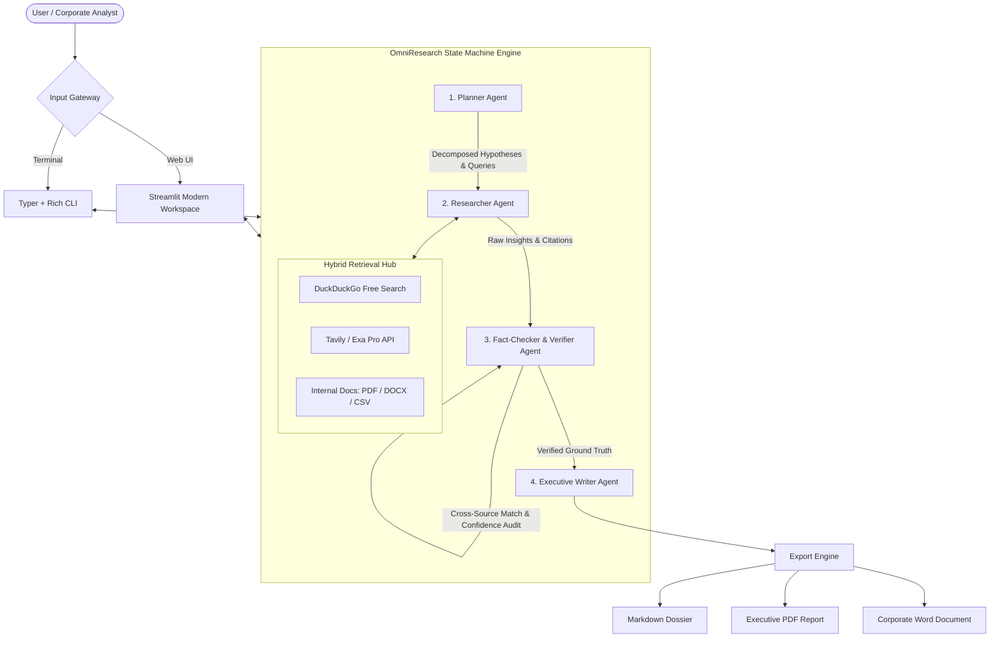

<div align="center">

# 🔍 OmniResearch
### Enterprise Autonomous Deep Research & Fact-Checked Intelligence Engine

[](LICENSE)
[](pyproject.toml)
[](#architecture)
[](#interfaces)
[](#anti-hallucination--fact-checking)

*Autonomous multi-agent intelligence platform that navigates the public web and private enterprise archives to generate executive-ready, mathematically cited dossiers.*

[Key Features](#key-features) • [Architecture](#architecture) • [Quick Start](#quick-start) • [Interfaces](#interfaces) • [Enterprise Deployment](#enterprise-deployment)

---

</div>

## 📌 Overview

**OmniResearch** bridges the critical gap between raw LLM chat assistants and corporate decision-making. Traditional RAG systems often produce superficial summaries, while naive web scrapers hallucinate citations and miss nuances in private enterprise documents.

OmniResearch implements an autonomous **Multi-Agent State Machine** that recursively plans sub-topics, gathers evidence across hybrid data sources (live web search + uploaded internal enterprise documents), runs an autonomous **anti-hallucination verification loop**, and compiles verifiable **Executive Dossiers** exported to Markdown, PDF, and DOCX.

---

## ⚡ Key Features

- 🤖 **Multi-Agent Orchestration**: Specialized agents for planning (`Planner`), multi-source investigation (`Researcher`), ground-truth verification (`Verifier`), and executive synthesis (`Writer`).
- 🌐 **Zero-Cost Out of the Box**: Includes built-in **DuckDuckGo Search & Web Scraper** requiring **zero paid search API keys** to run immediately. Optionally plug in Tavily or Exa for specialized enterprise search.
- 📁 **Hybrid Retrieval**: Research public web sources and private corporate documents (`.pdf`, `.docx`, `.csv`, `.md`) concurrently.
- 🛡️ **Anti-Hallucination Verifier**: Audits numbers, metrics, and critical claims against primary source texts, assigning an empirical **Confidence Score** to each statement.
- 🏢 **Model Agnostic & Private**: Works with leading cloud models (**Google Gemini**, **OpenAI**, **Anthropic Claude**) or fully on-premise with **Ollama / vLLM** (Llama 3.3, DeepSeek, Qwen) for sensitive air-gapped data.
- 📊 **Executive Multi-Format Deliverables**: Generates publication-ready reports with numbered citations, comparative matrices, executive summaries, and direct export to **PDF** and **DOCX**.
- 💻 **Dual Interfaces**: Seamlessly toggle between a visual **Streamlit Web Dashboard** and a high-performance **Rich CLI** with live telemetry.

---

## 🏛️ Architecture



---

## 🚀 Quick Start

### 1. Clone & Setup

```bash
git clone https://github.com/davinmaritza/omniresearch.git
cd omniresearch

# Recommended: create virtual environment with uv or python venv
uv venv
source .venv/bin/activate
uv pip install -e .
```

### 2. Configure Environment

Copy the example environment file:
```bash
cp .env.example .env
```

Configure your preferred LLM provider in `.env` (e.g. Gemini, OpenAI, or local Ollama):
```env
LLM_PROVIDER=gemini
GEMINI_API_KEY=your_gemini_api_key_here
SEARCH_PROVIDER=duckduckgo
```

---

## 🖥️ Interfaces

### A. Modern Web Dashboard (Streamlit)

Launch the interactive web workstation:
```bash
omniresearch web
# or: streamlit run src/omniresearch/web.py
```
*Features interactive research configuration, document drag-and-drop, real-time node progress streaming, citation inspector, and 1-click PDF/DOCX downloads.*

### B. High-Performance Terminal CLI

Run autonomous deep research straight from your terminal:
```bash
# Research a market topic
omniresearch run "AI Chip Market Competitors: Nvidia vs AMD vs Custom Silicon 2026"

# Research with private internal document context
omniresearch run "Q3 Financial Performance Analysis" --docs ./internal_data/quarterly_report.pdf --export pdf
```

---

## 🛡️ Anti-Hallucination & Fact-Checking

Enterprise executives require verifiable claims. OmniResearch's **Verifier Agent** processes candidate assertions through a 3-step verification protocol:

1. **Named Entity & Metric Extraction**: Identifies every statistical metric, financial figure, and quantitative assertion.
2. **Ground-Truth Source Verification**: Traces the claim back to the raw fetched text chunk.
3. **Confidence Scoring**: Assigns a reliability metric:
   - 🟢 **High (≥ 90%)**: Direct match in primary source.
   - 🟡 **Moderate (70% - 89%)**: Inferred from secondary corroboration.
   - 🔴 **Flagged (< 70%)**: Marked as unverified in the appendix for human review.

---

## 📂 Repository Structure

```
omniresearch/
├── src/
│   └── omniresearch/
│       ├── cli.py             # Rich CLI entrypoint
│       ├── web.py             # Streamlit visual dashboard
│       ├── config.py          # Unified settings & LLM provider factory
│       ├── core/
│       │   ├── state.py       # Pydantic Schemas & State Graph
│       │   └── graph.py       # LangGraph multi-agent workflow
│       ├── agents/
│       │   ├── planner.py     # Sub-query decomposition agent
│       │   ├── researcher.py  # Hybrid web & doc retrieval agent
│       │   ├── verifier.py    # Fact-checking & confidence score node
│       │   └── writer.py      # Executive dossier synthesis agent
│       ├── tools/
│       │   ├── search.py      # DuckDuckGo, Tavily & Exa adapters
│       │   ├── document.py    # PDF, DOCX, CSV parsers
│       │   └── scraper.py     # Dynamic web content extractor
│       └── exporters/
│           ├── markdown.py    # Markdown formatter
│           ├── pdf.py         # PDF report generator
│           └── docx.py        # DOCX report generator
├── tests/                     # Comprehensive test suites
├── docs/                      # Technical & enterprise architecture docs
├── pyproject.toml             # Project manifest & dependencies
└── LICENSE                    # Apache-2.0 License
```

---

## 📄 License

This project is licensed under the **Apache License 2.0** — see the [LICENSE](LICENSE) file for details.

---

<div align="center">
<sub>Built with precision for enterprise intelligence research. Contributions and issues welcome!</sub>
</div>
