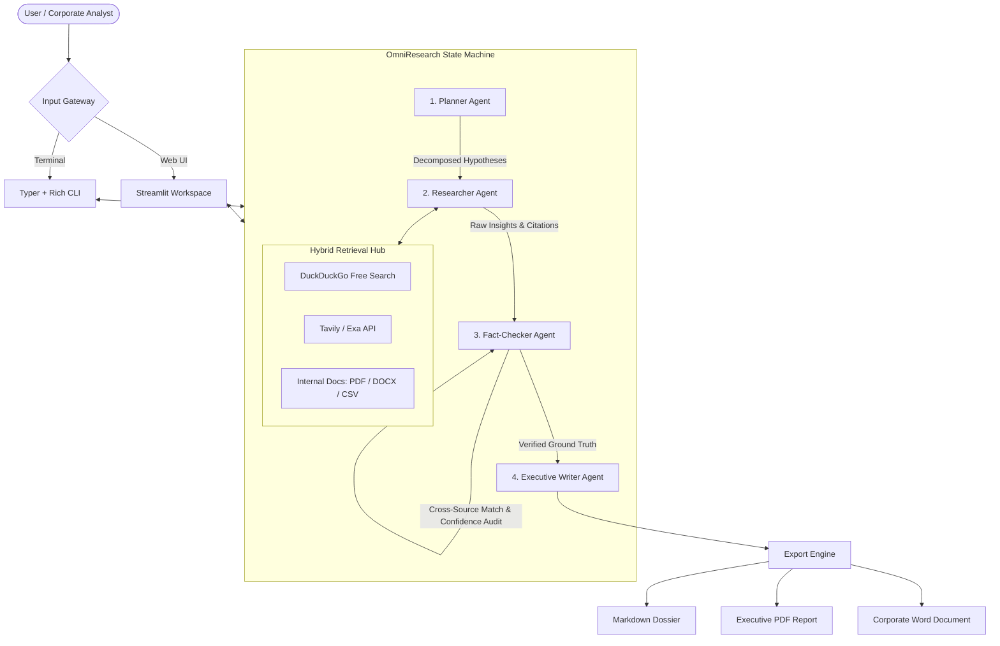

<div align="center">

# OmniResearch
### Autonomous Deep Research and Fact-Checked Intelligence Engine

[](LICENSE)
[](pyproject.toml)
[](#architecture)
[](#interfaces)
[](#verification-and-fact-checking)

Autonomous multi-agent system that searches the public web and private enterprise archives to generate verified, cited executive dossiers.

[Features](#features) • [Architecture](#architecture) • [Quick Start](#quick-start) • [Interfaces](#interfaces) • [Verification](#verification-and-fact-checking) • [Repository Structure](#repository-structure)

---

</div>

## Overview

Most LLM research tools fail in corporate settings for two reasons: they hallucinate numerical claims, and they cannot cross-reference public web intelligence with private internal documentation.

OmniResearch runs an autonomous multi-agent state machine that plans investigative tracks, collects evidence from hybrid sources, audits every critical factual assertion against primary text excerpts, and exports formatted dossiers to Markdown, PDF, and DOCX.

## Features

- Multi-agent state machine. Divides research between four focused agents: Planner, Researcher, Verifier, and Writer.
- Zero-cost web search. Runs out of the box using DuckDuckGo search and clean web scraping without requiring paid search API keys. Supports Tavily and Exa adapters when configured.
- Hybrid retrieval. Ingests local corporate files (.pdf, .docx, .csv, .md) alongside live web queries.
- Automated claim verification. Matches numbers, statistics, and critical assertions against source snippets, assigning an empirical confidence score from 0 to 100%.
- Model-agnostic LLM client. Connects to Google Gemini, OpenAI, Anthropic Claude, or local Ollama instances (Llama 3.3, DeepSeek, Qwen) for air-gapped security.
- Multi-format deliverables. Exports structured dossiers to Markdown, Word (.docx), and PDF with numbered source citations.
- Dual interfaces. Provides a Streamlit web workstation and a Rich CLI for terminal workflows.

## Architecture



## Quick Start

### 1. Clone and Setup

```bash
git clone https://github.com/davinmaritza/omniresearch.git
cd omniresearch

# Create virtual environment and install dependencies
uv venv
source .venv/bin/activate
uv pip install -e ".[dev]"
```

### 2. Configure Environment

Copy the example environment file:
```bash
cp .env.example .env
```

Configure your preferred model provider in `.env` (Gemini, OpenAI, Anthropic, or local Ollama):
```env
LLM_PROVIDER=gemini
GEMINI_API_KEY=your_gemini_api_key_here
SEARCH_PROVIDER=duckduckgo
```

If no API keys are provided, OmniResearch runs with its built-in offline heuristic engine and DuckDuckGo search so you can test the entire pipeline immediately.

## Interfaces

### Web Dashboard (Streamlit)

Launch the interactive workstation:
```bash
python -m omniresearch.cli web
# or: streamlit run src/omniresearch/web.py
```
The web dashboard provides drag-and-drop document upload, live agent status telemetry, a searchable fact-check table, and 1-click downloads for Markdown, PDF, and DOCX files.

### Terminal CLI

Run deep research directly from the command line:
```bash
# Research a market topic
python -m omniresearch.cli run "AI Chip Market Competitors: Nvidia vs AMD vs Custom Silicon 2026"

# Research with private local documents
python -m omniresearch.cli run "Q3 Performance Review" --docs ./data/internal_q3.pdf --export md,pdf,docx --out ./reports
```

To audit system readiness and configured providers:
```bash
python -m omniresearch.cli check
```

## Verification and Fact-Checking

Unverified figures are liabilities in business decisions. OmniResearch routes all candidate evidence through the Verifier Agent before synthesis:

1. Named entity and metric extraction. Isolates numerical claims, dates, and market metrics.
2. Ground-truth cross-matching. Traces claims back to raw snippet chunks or document pages.
3. Confidence score assignment:
   - High (>= 85%): Direct corroboration in primary evidence.
   - Moderate (70% - 84%): Inferred from secondary corroboration.
   - Unverified (< 70%): Flagged in the appendix table for manual analyst review.

## Repository Structure

```
omniresearch/
├── src/
│   └── omniresearch/
│       ├── cli.py             # Typer + Rich CLI entrypoint
│       ├── web.py             # Streamlit visual dashboard
│       ├── config.py          # Configuration and settings schema
│       ├── core/
│       │   ├── state.py       # Pydantic state models and schemas
│       │   ├── graph.py       # Multi-agent state machine workflow
│       │   └── llm.py         # Multi-provider LLM client adapter
│       ├── agents/
│       │   ├── planner.py     # Sub-query decomposition agent
│       │   ├── researcher.py  # Hybrid web and document retrieval agent
│       │   ├── verifier.py    # Fact-checking and confidence scoring agent
│       │   └── writer.py      # Executive dossier synthesis agent
│       ├── tools/
│       │   ├── search.py      # DuckDuckGo, Tavily, and Exa search adapters
│       │   ├── document.py    # PDF, DOCX, and CSV document parsers
│       │   └── scraper.py     # HTML text extraction utility
│       └── exporters/
│           ├── markdown.py    # Markdown report exporter
│           ├── pdf.py         # ReportLab PDF generator
│           └── docx.py        # Word document generator
├── tests/
│   └── test_pipeline.py       # End-to-end integration test suite
├── docs/                      # Architecture and enterprise documentation
├── pyproject.toml             # Project manifest and dependencies
└── LICENSE                    # Apache-2.0 License
```

## Testing

Run the test suite with pytest:
```bash
pytest -v
```

## License

Apache License 2.0. See [LICENSE](LICENSE) for details.
